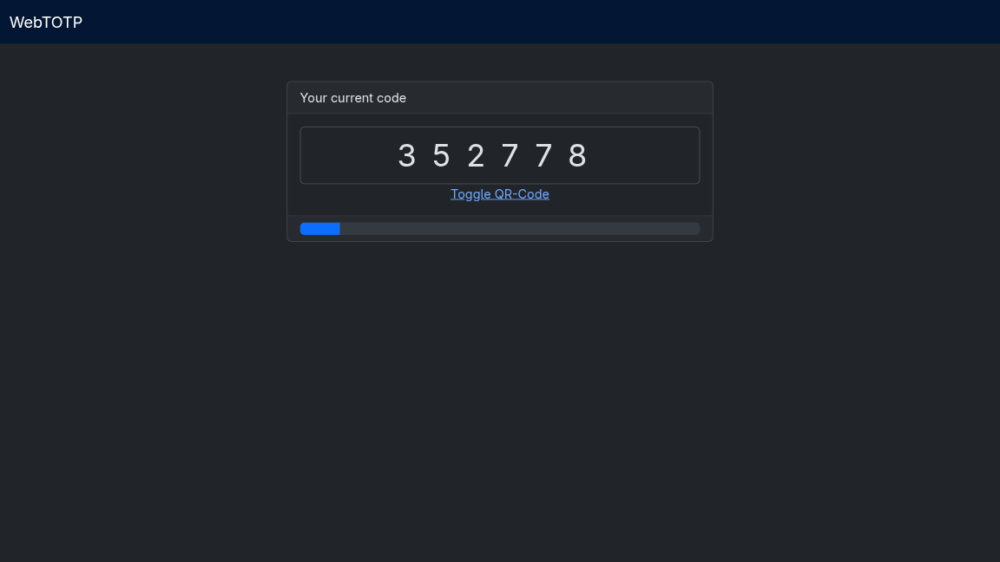

# Luzifer / webtotp

`webtotp` is a small web-based utility for generating ad-hoc TOTP codes, similar to Google Authenticator. It runs entirely in your browser and does not send any data to a service.

I use it for accounts whose OTP secrets are stored outside my regular TOTP generator. I rarely need access to those accounts, and adding their secrets to my generator would clutter it with many entries. Instead, I keep the secrets in a safe place and use this utility to generate a single OTP token when needed.

You can also share a page that already contains the OTP code by appending the secret to the URL hash:

```text
https://luzifer.github.io/webtotp/#JBSWY3DPEHPK3PXP
```

As long as the secret is in the hash (after the `#`), the browser does not send it to the server; it remains local to the browser. When sharing a URL containing a secret, use a secure transport such as [OTS](https://ots.fyi/) so that chat or email providers cannot fetch the secret from the URL.



## Installation

Use the provided Docker image from GHCR:

```console
docker run --rm -ti -p 3000:3000 ghcr.io/luzifer/webtotp
```

Alternatively, build the static files yourself and serve the contents of `dist/` with any static web server:

```console
make prod
```

The build requires [pnpm](https://pnpm.io/), Node.js, and `make`.

```text
dist
├── app.css
├── app.js
└── index.html

0 directories, 3 files
```
